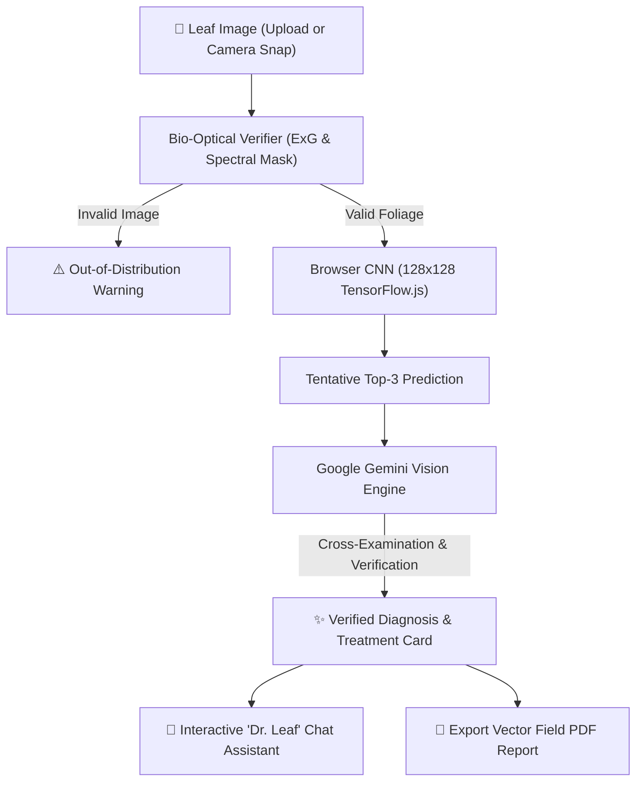

# 🌿 LeafCare AI (v2.0 Pro)
### *Next-Generation Autonomous Plant Pathology & Crop Diagnostics*

[](https://react.dev/)
[](https://fastapi.tiangolo.com/)
[](https://www.tensorflow.org/js)
[](https://aistudio.google.com/)
[](https://tailwindcss.com/)

**LeafCare AI** is a dual-engine agricultural intelligence platform designed to detect, diagnose, and treat plant leaf diseases with clinical precision. It merges **sub-second on-device Convolutional Neural Networks (CNNs)** running in the browser with **Google Gemini Multimodal Vision & Reasoning** to provide automated auto-verification and an interactive AI agronomist ("Dr. Leaf").

---

## 🌟 Key Highlights

- ⚡ **Dual-Engine Diagnostic Pipeline**:
  - **Tier 1 (Instant Edge CNN)**: Runs directly in your browser using `@tensorflow/tfjs` in ~50ms.
  - **Tier 2 (Gemini Vision Auto-Verifier)**: Uses Gemini 3.5 to visually cross-examine foliar venation, margins, and lesion halos to correct any false-positive guesses and support **any global crop**.
- 💬 **Interactive "Dr. Leaf" AI Agronomist**:
  - Context-aware chat grounded in your uploaded leaf image. Ask questions about organic home remedies, fungicide dilution ratios (ml/L), spray schedules, and harvest safety.
- 🛡️ **Bio-Optical OOD Filter**:
  - Analyzes Excess Green Index ($\text{ExG} = 2G - R - B$) and spatial texture variance to reject non-leaf images (cars, shoes, faces) before running inference.
- 📄 **1-Click Field PDF Reports**:
  - Exports vector-sharp diagnostic advisories with clinical symptom lists, severity tags, and integrated pest management (IPM) plans.
- 📸 **Field-Ready Camera Mode**:
  - Built-in live camera modal with reticle alignment for mobile and field scouting.
- 🎨 **Modern Light UI/UX**:
  - Multi-colored, accessible aesthetic using fresh botanic greens, solar amber, and coral warning palettes.

---

## 🏗️ Architecture Overview



---

## 🌿 Supported Crops & Pathologies

The built-in client-side model supports **14 major agricultural crops** across **38 pathological classes**:

| Crop | Supported Diseases / Conditions |
|---|---|
| **Tomato** | Bacterial Spot, Early Blight, Late Blight, Leaf Mold, Septoria Leaf Spot, Spider Mites, Target Spot, Mosaic Virus, Yellow Leaf Curl Virus, Healthy |
| **Potato** | Early Blight, Late Blight, Healthy |
| **Apple** | Apple Scab, Black Rot, Cedar Apple Rust, Healthy |
| **Corn (Maize)** | Cercospora Gray Leaf Spot, Common Rust, Northern Leaf Blight, Healthy |
| **Grape** | Black Rot, Esca (Black Measles), Leaf Blight (Isariopsis Spot), Healthy |
| **Bell Pepper** | Bacterial Spot, Healthy |
| **Peach** | Bacterial Spot, Healthy |
| **Cherry** | Powdery Mildew, Healthy |
| **Strawberry** | Leaf Scorch, Healthy |
| **Orange / Citrus** | Huanglongbing (Citrus Greening) |
| **Squash** | Powdery Mildew |
| **Blueberry** | Healthy Foliage Verification |
| **Raspberry** | Healthy Foliage Verification |
| **Soybean** | Healthy Foliage Verification |

> **Note**: Through **Gemini Vision**, LeafCare AI can also identify and advise on **thousands of additional crops** (Rice, Wheat, Mango, Coffee, Cassava, Bananas, ornamental plants, houseplants, etc.).

---

## 🚀 Quickstart Guide

### Prerequisites
- **Node.js** v18+ and **npm**
- **Python** 3.9+

### 1. Clone the Repository
```bash
git clone https://github.com/sagarsuryavamshi/LeafCare-AI.git
cd LeafCare-AI
```

### 2. Set Up the Backend (FastAPI)
```bash
# Navigate to backend and create virtualenv
cd backend
python3 -m venv venv
source venv/bin/activate  # On Windows: venv\Scripts\activate

# Install dependencies
pip install -r requirements.txt

# Configure your Gemini API Key
cp .env.example .env
# Edit .env and paste your GEMINI_API_KEY from Google AI Studio
```

Run the backend server:
```bash
uvicorn main:app --host 0.0.0.0 --port 8000 --reload
```
*API documentation will be available at [http://localhost:8000/docs](http://localhost:8000/docs)*.

### 3. Set Up the Frontend (React + Vite)
In a new terminal window:
```bash
cd frontend
npm install
npm run dev
```
Open **[http://localhost:5173/](http://localhost:5173/)** in your browser.

---

## 🤖 Adding New Crops (Custom Training Pipeline)

LeafCare AI includes a training and export script to fine-tune new crops and export them straight to TensorFlow.js:

```bash
python backend/train_and_export.py \
    --data_dir /path/to/dataset \
    --epochs 15 \
    --export_dir ./frontend/public/tfjs_model
```
- Trains a **MobileNetV3** transfer learning architecture.
- Automatically generates updated `class_names.json` and `.bin` weight shards.
- The React UI automatically detects and loads the new labels on startup!

---

## 🔑 Environment Variables

Create a `backend/.env` file with the following variables:

```env
# Google Gemini API Key (Get a free key from https://aistudio.google.com/app/apikey)
GEMINI_API_KEY=your_gemini_api_key_here

PORT=8000
HOST=0.0.0.0
```

*(You can also connect or update your Gemini API key directly in the web UI via the **Connect Gemini API** header button)*.

---

## 🛡️ Privacy & Security
- **No Mandatory Cloud Storage**: Your leaf images are processed in-memory or directly on-device in the browser.
- **Client-Side Secrets**: Your Gemini API key is stored strictly in your browser's private local storage or in your local `.env` file; it is never shared or logged.

---

## 📜 License
This project is licensed under the MIT License — feel free to use and adapt it for academic research, farm management, or commercial applications.
